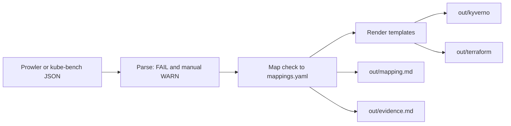

# k8s-remediate-nis2

**Turn a failed Prowler or kube-bench report into reviewable Kyverno and Terraform fixes, mapped to NIS2 Article 21.**

[](https://github.com/sv222/k8s-remediate-nis2/actions/workflows/ci.yml)
[](LICENSE)

`k8s-remediate-nis2` is a small Go command line tool. It reads the JSON report of
Prowler (AWS) or kube-bench (Kubernetes). For each failed check it writes a Kyverno
policy or a Terraform file, a `mapping.md` table and an optional `evidence.md` report.
It does not scan anything itself.

## The problem

Scanners list hundreds of failed checks. Engineers still write each fix by hand.
They also write the audit evidence by hand: which check failed, which article it
relates to and what changed. This tool automates the repeatable part. A person
still reviews every result.

## 30-second demo

The input is the test reports in this repo. They are derived from real Prowler 5.45
(OCSF) and kube-bench 0.16 (JSON) output. The output below is from a real run.

```sh
k8s-remediate-nis2 remediate \
  --prowler cmd/testdata/prowler_ocsf.json \
  --kube-bench cmd/testdata/kube_bench.json \
  --out out --export-evidence
```

```text
failed findings: 26, files written: 13, output: out
```

```text
out/
  kyverno/     block_hostnet.yaml  block_privileged.yaml  require_nonroot.yaml
  terraform/   s3_public_access_block__acme-public-logs.tf
               s3_encryption_kms__acme-backup-dump.tf
               sg_restrict_ingress__sg-a899c3f6063affe1f.tf
               ... 10 files in total, with shared variables_*.tf
  mapping.md
  evidence.md
```

One generated file, `terraform/s3_public_access_block__acme-public-logs.tf`:

```hcl
# Remediation for: S3 bucket without Block Public Access
# Articles: NIS2 Art.21(2)(i), NIS2 Art.21(2)(g), DORA Art.9, ISO27001:2022 A.8.3
resource "aws_s3_bucket_public_access_block" "remediation_acme-public-logs" {
  bucket = "acme-public-logs"

  block_public_acls       = true
  block_public_policy     = true
  ignore_public_acls      = true
  restrict_public_buckets = true
}
```

Some rows of `mapping.md` (the Articles and Note columns are left out here):

```text
| Scanner    | Check                               | Resource         | Generated                                             | Status        |
|------------|-------------------------------------|------------------|-------------------------------------------------------|---------------|
| prowler    | s3_bucket_public_access             | acme-public-logs | terraform/s3_public_access_block__acme-public-logs.tf | remediated    |
| prowler    | eks_cluster_not_publicly_accessible | acme-eks         |                                                       | guidance only |
| kube-bench | 5.2.2                               | cluster          | kyverno/block_privileged.yaml                         | remediated    |
| kube-bench | 1.2.5                               | cluster          |                                                       | no mapping    |
```

The top of `evidence.md`. It also lists the SHA-256 of each input file.

```text
Findings: 143 | Failed: 26 | Remediated: 13 | Guidance only: 1 | Unmapped: 12 | Skipped: 0
```

## Notice and disclaimer

> Technical Remediation & Evidence Assistant for NIS2/DORA. This tool does not certify compliance; risk acceptance remains with the client's management.

> **Important:** The NIS2, DORA and ISO 27001 mappings in this project have NOT
> been reviewed by legal or compliance experts. Do not use them as legal or
> audit advice. DORA Art.9 applies only to financial entities.

## Quickstart

Install with Go 1.23 or later, or build from source:

```sh
go install github.com/sv222/k8s-remediate-nis2/cmd/k8s-remediate-nis2@latest

git clone https://github.com/sv222/k8s-remediate-nis2.git
cd k8s-remediate-nis2 && make build && ./bin/k8s-remediate-nis2 --version
```

```sh
prowler aws -M json-ocsf                    # 1. scan AWS
kube-bench run --json > bench.json          # 1. scan Kubernetes
k8s-remediate-nis2 remediate --prowler prowler.ocsf.json --kube-bench bench.json \
  --out remediation/ --export-evidence      # 2. generate fixes
kubectl apply -f remediation/kyverno/       # 4. apply policies (Audit mode)
terraform plan                              # 5. plan, then apply what you understand
```

Step 3 is yours: read `remediation/mapping.md` and every generated file.

Flags: `--prowler FILE`, `--kube-bench FILE`, `--out DIR` (default `./remediation`),
`--export-evidence`. Use at least one scanner flag. Exit code `0` means success, also
when some findings have no mapping. Exit code `2` means an error.

### Safety rules

- Kyverno policies start in `Audit` mode. Read the policy reports first, then change
  `validationActions` to `Deny`. They skip `kube-system`, `kube-public`,
  `kube-node-lease` and `kyverno`.
- Review all Terraform before `terraform apply`. Risky files start with a `WARNING`.
  `s3_secure_transport` replaces the whole bucket policy and denies plain HTTP: put the
  current policy into `var.s3_existing_bucket_policies` first. `s3_acl_prohibited`
  disables all ACLs of a bucket.
- The security group template only adds one narrow rule. You set `var.allowed_cidr`
  and `var.allowed_port`, and you revoke the open rules yourself.
- Some checks are guidance only on purpose. EKS endpoint settings are not in your
  Terraform state, and a wrong change cuts off `kubectl`. Network ACLs are stateless and
  cover whole subnets, so a wrong rule drops traffic at once. For these, `mapping.md`
  gives exact steps, not code.
- Resource IDs are validated before they reach a template. Bad IDs are listed as
  `skipped: invalid resource id`.

### Supported input

- Prowler `json-ocsf` (`prowler -M json-ocsf`) and the legacy `json` of Prowler 3.
  Prowler ASFF output is not supported.
- kube-bench JSON. IDs are mapped for the CIS, EKS, AKS, GKE, ACK, k3s, RKE, RKE2,
  OpenShift, MicroK8s and TKGI benchmarks listed in `mapping/mappings.yaml`.
- In `cis-1.12`, kube-bench reports the pod security controls as manual `WARN`, never
  `FAIL`. The tool treats a manual `WARN` of a mapped control as a gap. It also reads the
  `(Manual)` ending of the control text, because `type` can be empty.

## Supported checks

Generated from `mapping/mappings.yaml`. NIS2 letters are Article 21(2) points:
(b) incident handling, (g) basic cyber hygiene, (h) cryptography and encryption,
(i) access control and asset management. These are short summaries, not legal text.
DORA references are in `mapping.md`.

| Scanner | Check | What the fix does | NIS2 | ISO 27001:2022 | Type |
|---|---|---|---|---|---|
| prowler | `s3_bucket_level_public_access_block`, `s3_bucket_public_access`, `s3_bucket_public_list_acl`, `s3_bucket_public_write_acl`, `s3_bucket_policy_public_write_access` | Turns on all four S3 Block Public Access settings | (i), (g) | A.8.3 | template |
| prowler | `s3_bucket_default_encryption` (deprecated in current Prowler) | Default SSE-S3 (AES256) encryption | (h) | A.8.24 | template |
| prowler | `s3_bucket_kms_encryption` | Default SSE-KMS encryption with `var.kms_key_arn` | (h) | A.8.24 | template |
| prowler | `s3_bucket_secure_transport_policy` | Bucket policy that denies plain HTTP | (h) | A.8.24, A.8.20 | template |
| prowler | `s3_bucket_server_access_logging_enabled` | Server access logs to `var.access_log_bucket` | (b) | A.8.15, A.8.16 | template |
| prowler | `s3_bucket_acl_prohibited` | `BucketOwnerEnforced`, which disables ACLs | (i), (g) | A.5.15, A.8.3 | template |
| prowler | `ec2_ebs_default_encryption` | Default EBS encryption, one file per region | (h) | A.8.24 | template |
| prowler | `ec2_securitygroup_allow_ingress_from_internet_to_any_port`, `..._to_all_ports`, `..._to_tcp_port_22`, `..._to_tcp_port_3389`, `..._to_high_risk_tcp_ports` | Adds one narrow ingress rule | (i), (g) | A.8.20 | template |
| prowler | `eks_cluster_not_publicly_accessible`, `eks_cluster_private_nodes_enabled` | Steps to limit the public endpoint and enable the private one | (i), (g) | A.8.20 | guidance |
| prowler | `ec2_networkacl_allow_ingress_any_port`, `..._tcp_port_22`, `..._tcp_port_3389` | Steps to narrow the open entry | (i), (g) | A.8.20, A.8.22 | guidance |
| kube-bench | privileged containers (5.2.2; 5.2.1 and 4.2.1 in other benchmarks) | Kyverno `nis2-block-privileged` | (i), (g) | A.8.2 | template |
| kube-bench | host network (5.2.5; 5.2.4 and 4.2.4) | Kyverno `nis2-block-hostnetwork` | (i), (g) | A.8.22 | template |
| kube-bench | root containers (5.2.7; 5.2.6 and 4.2.6) | Kyverno `nis2-require-nonroot` | (i), (g) | A.8.2 | template |

The `regional` option applies to `ec2_ebs_default_encryption`. This setting exists per
AWS region, so the template gets the region of the finding and the file name includes it.

## How it works



- **It never widens access.** Templates only tighten settings. The security group
  template adds a narrow rule and deletes nothing. `var.allowed_cidr` rejects
  `0.0.0.0/0` and wide public ranges.
- **Guidance instead of unsafe automation.** If a change could lock out users or edit a
  resource Terraform does not own, the tool writes steps, not code.
- **The mapping is data.** Checks, articles and templates live in
  `mapping/mappings.yaml`. Templates are embedded in the binary.

## How it was tested

`make e2e` (`scripts/e2e.sh`, needs Docker) tests the AWS fixes against the Floci AWS
emulator. It creates bad resources for 20 Prowler checks and runs real Prowler 5.45. It
runs `remediate`, then Terraform 1.16.5 `validate`, `plan` and `apply`. Then it does the
follow-up steps from the guidance text and runs Prowler again. It fails if a covered check
still reports `FAIL`.

| Prowler scan | FAIL | PASS |
|---|---|---|
| Before | 50 | 51 |
| After `terraform apply` (36 resources added) | 13 | 88 |
| After the guidance follow-up steps | 0 | 103 |

The 13 failures after `apply` are open security group rules, network ACL entries and
EKS settings. The tool leaves these to you on purpose. The check
`ec2_securitygroup_allow_ingress_from_internet_to_any_port` cannot be created in the
emulator, so it was not tested. The emulator has no `UpdateClusterConfig`, so the EKS
step recreated the mock cluster with the target settings.

- **kube-bench:** a real kube-bench 0.16.0 run on Kubernetes 1.37 (kind) gave 63 PASS,
  12 FAIL and 56 WARN with the default service account. Controls 5.2.2, 5.2.5 and 5.2.7
  are manual `WARN` checks, and the tool handles them. kube-bench chose `cis-1.12` itself.
- **Kyverno:** `make policy-test` runs the three policies through the Kyverno 1.19.1 CLI
  against good and bad pods. A real Kyverno 1.19.1 admission also tested the three policies.
- **Unit tests:** `make test` compares output with golden files in `cmd/testdata/golden`.
  CI runs build, vet, test, gofmt and `go mod tidy`.

Not verified:

- Real AWS accounts. A green emulator run does not prove that AWS accepts every change.
- kube-bench output from EKS, AKS or GKE.
- Other kube-bench benchmark versions end to end. IDs are checked against kube-bench 0.16.0 only.
- Review of the mappings by legal or compliance experts.

## Limitations and roadmap

- The mapping set is small. Many failed checks show `no mapping`.
- The tool does not scan and does not remove existing rules.
- Terraform files are snippets per resource. You merge them into your own code and state.
- Roadmap: review of the mappings by compliance experts, more Prowler checks, and
  kube-bench tests with managed Kubernetes output.

## Contributing

To add a mapping: add a template under `templates/`, add an entry to
`mapping/mappings.yaml` (`scanner`, `check_id` or `benchmark_ids`, `title`, `articles`,
and `templates` or `guidance`), add a test input and golden files in `cmd/testdata`,
then run `make test` (and `make e2e` for AWS templates).

If you work in compliance, audit or law, please review the article references. Open an
issue or a pull request for any reference that is wrong or too broad. See
`CONTRIBUTING.md`. Report security problems through GitHub private vulnerability
reporting. See `SECURITY.md`.

## License

Apache-2.0. See `LICENSE`.
