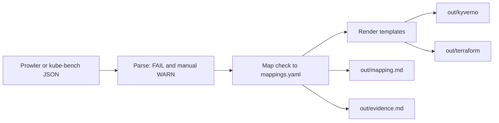

# k8s-remediate-nis2

**Turn a failed Prowler or kube-bench report into reviewable Kyverno and Terraform fixes, mapped to NIS2 Article 21.**

[](https://github.com/sv222/k8s-remediate-nis2/actions/workflows/ci.yml)
[](LICENSE)

`k8s-remediate-nis2` is a small Go command line tool. It reads the JSON report of
Prowler (AWS) or kube-bench (Kubernetes). For each failed check it writes a Kyverno
policy or a Terraform file, a `mapping.md` table and an optional `evidence.md` report.
It does not scan anything itself.

## The problem

Scanners list hundreds of failed checks. Engineers still write each fix by hand.
They also write the audit evidence by hand: which check failed, which article it
relates to and what changed. This tool automates the repeatable part. A person
still reviews every result.

## 30-second demo

The input is the test reports in this repo. They are derived from real Prowler 5.45
(OCSF) and kube-bench 0.16 (JSON) output. The output below is from a real run.

```sh
k8s-remediate-nis2 remediate \
  --prowler cmd/testdata/prowler_ocsf.json \
  --kube-bench cmd/testdata/kube_bench.json \
  --out out --export-evidence
```

```text
failed findings: 27, files written: 14 (nothing is applied), output: out
```

```text
out/
  kyverno/     block_hostnet.yaml  block_hostpid.yaml  block_privileged.yaml  require_nonroot.yaml
  terraform/   s3_public_access_block__acme-public-logs.tf
               s3_encryption_kms__acme-backup-dump.tf
               sg_restrict_ssh__sg-a899c3f6063affe1f.tf
               ... 10 files in total, with shared variables_*.tf and versions.tf
  mapping.md
  evidence.md
  manifest.json
```

One generated file, `terraform/s3_public_access_block__acme-public-logs.tf`:

```hcl
# Remediation for: S3 bucket without Block Public Access; S3 bucket publicly accessible
# Articles: NIS2 Art.21(2)(i), NIS2 Art.21(2)(g), DORA Art.9, DORA RTS 2024/1774 Art.21, NIS2 CIR 2024/2690 Annex 11.1, ISO27001:2022 A.8.3
# WARNING: Block Public Access removes all public access to acme-public-logs. Buckets that are public on purpose
# (static websites, public downloads) and CloudFront distributions that read the bucket without Origin Access Control
# stop serving content to the public. Check who reads the bucket first: aws s3api get-bucket-policy-status --bucket acme-public-logs
resource "aws_s3_bucket_public_access_block" "remediation_acme-public-logs" {
  bucket = "acme-public-logs"

  block_public_acls       = true
  block_public_policy     = true
  ignore_public_acls      = true
  restrict_public_buckets = true
}
```

Some rows of `mapping.md` (the Articles and Note columns are left out here). `code generated`
and `follow-up required` mean a file was written, not that the finding is fixed:

```text
| Scanner    | Check                               | Resource         | Generated                                             | Status             |
|------------|-------------------------------------|------------------|-------------------------------------------------------|--------------------|
| prowler    | s3_bucket_public_access             | acme-public-logs | terraform/s3_public_access_block__acme-public-logs.tf | code generated     |
| prowler    | eks_cluster_not_publicly_accessible | acme-eks         |                                                       | guidance only      |
| kube-bench | 5.2.2                               | cluster          | kyverno/block_privileged.yaml                         | follow-up required |
| kube-bench | 1.2.5                               | cluster          |                                                       | no mapping         |
```

The top of `evidence.md`. It says that nothing was applied. It also lists the SHA-256 of
each input file (of the bytes that were parsed) and of each generated file, the mapping
version, the AWS account and the open items per row.

```text
Records read: 143 | Failed findings (FAIL): 23 | Manual WARN treated as gap: 4 | Passed: 66 | Manual or not assessed: 50 | Other status: 0 | Suppressed (muted): 0 | Duplicate records ignored: 0
Status of the 27 rows below: code generated: 6 | follow-up required: 7 | guidance only: 2 | no mapping: 12 | skipped: 0
```

## Notice and disclaimer

> Technical Remediation & Evidence Assistant for NIS2/DORA. This tool does not certify compliance; risk acceptance remains with the client's management.

> **Important:** The NIS2, DORA and ISO 27001 mappings in this project have NOT
> been reviewed by legal or compliance experts. Do not use them as legal or
> audit advice. DORA Art.9 applies only to financial entities.
>
> References to Delegated Regulation (EU) 2024/1774 (DORA RTS) and Implementing
> Regulation (EU) 2024/2690 were checked against the EUR-Lex text for the article
> or annex title only. Whether a rule applies to your entity was not assessed:
> 2024/1774 is for financial entities, and 2024/2690 is only for DNS, TLD,
> cloud, data centre, CDN, managed service, managed security service, marketplace,
> search engine, social network and trust service providers. The ISO 27001:2022
> controls are loose matches, not an audit result.
>
> **Nothing is applied by this tool.** It writes files. Status `code generated`
> does not mean a finding is fixed.

## Quickstart

Install with Go 1.26 or later, or build from source:

```sh
go install github.com/sv222/k8s-remediate-nis2/cmd/k8s-remediate-nis2@latest

git clone https://github.com/sv222/k8s-remediate-nis2.git
cd k8s-remediate-nis2 && make build && ./bin/k8s-remediate-nis2 --version
```

```sh
prowler aws -M json-ocsf                    # 1. scan AWS
kube-bench run --json > bench.json          # 1. scan Kubernetes
k8s-remediate-nis2 remediate --prowler prowler.ocsf.json --kube-bench bench.json \
  --out remediation/ --export-evidence      # 2. generate fixes
kubectl apply -f remediation/kyverno/       # 4. apply policies (Audit mode)
terraform plan                              # 5. plan, then apply what you understand
```

Step 3 is yours: read `remediation/mapping.md` and every generated file.

Flags: `--prowler FILE`, `--input-format auto|ocsf|json|asff` (default `auto`), `--kube-bench FILE`,
`--out DIR` (default `./remediation`), `--format text|sarif` (default `text`), `--export-evidence`,
`--force`. Use at least one scanner flag. The output directory
must be empty. `--force` allows a non-empty directory and removes only the files listed
in its `manifest.json` from the previous run, so old `.tf` files cannot be applied by
accident. Exit code `0` means success, also when some findings have no mapping. Exit
code `2` means an error.

`--format sarif` prints SARIF 2.1.0 to stdout and the summary line to stderr. Each row of
`mapping.md` is one result. Its location is the first generated file, or the input report when
nothing was generated. Use a relative `--out` and input path, so code scanning can link the files:

```sh
k8s-remediate-nis2 remediate --prowler prowler.ocsf.json --out remediation --format sarif > nis2.sarif
```

Upload `nis2.sarif` with `github/codeql-action/upload-sarif`. Severity `critical` and `high` become
`error`, `medium` becomes `warning`, the rest `note`. kube-bench findings are `medium`.

A Prowler report must hold one AWS account. A report with several accounts is refused:
run the tool once per account. Muted (suppressed) Prowler findings are not remediated.
They are counted and listed in `evidence.md`.

### Safety rules

- Kyverno policies start in `Audit` mode. Read the policy reports first, then change
  `validationActions` to `Deny`. They skip `kube-system`, `kube-public`,
  `kube-node-lease` and `kyverno`.
- Review all Terraform before `terraform apply`. Risky files start with a `WARNING`.
  `s3_secure_transport` replaces the whole bucket policy and denies plain HTTP: put the
  current policy into `var.s3_existing_bucket_policies` first. `s3_acl_prohibited`
  disables all ACLs of a bucket.
- The security group templates only add one narrow rule, and only for SSH (22) or
  RDP (3389), because those checks name the port. The rule file has a CIDR map per
  security group ID (`ssh_allowed_cidr`, `rdp_allowed_cidr`), so one group never gets a
  port that was flagged on another group. You revoke the open rule yourself: the finding
  stays open until you do. Checks that do not name a port are guidance only.
- `iam_password_policy` replaces the whole account password policy. Copy settings you
  keep, such as `max_password_age`, into the file first. Existing passwords are not checked
  until users change them.
- `cloudtrail_multi_region` creates a new trail. If a trail already logs management events,
  the new one is a paid second copy: turn on multi-region for the existing trail instead.
- Kyverno policies also match `pods/ephemeralcontainers` (for `kubectl debug`). This was
  not tested on a live cluster.
- SSE-KMS breaks S3 and ELB log delivery to a bucket. List log target buckets in
  `kms_excluded_buckets`. Keys are per region (`kms_key_arns`).
- Some checks are guidance only on purpose. EKS endpoint settings are not in your
  Terraform state, and a wrong change cuts off `kubectl`. MFA needs the person who holds
  the device, and EKS secrets encryption cannot be turned off again. Network ACLs are
  stateless and cover whole subnets, so a wrong rule drops traffic at once. For these, `mapping.md`
  gives exact steps, not code.
- Resource IDs are validated before they reach a template. Bad IDs are listed as
  `skipped`. In the reports, IDs are shown as code spans with a strict character set, so a
  crafted ID cannot add links or images.

### Supported input

- Prowler `json-ocsf` (`prowler -M json-ocsf`), `json-asff` (`prowler -M json-asff`) and the
  legacy `json` of Prowler 3. The format is detected per record. `--input-format` makes a
  mismatch an error. ASFF has only the resource ARN, so the resource name is taken from the
  ARN (`arn:aws:s3:::bucket` becomes `bucket`, `.../vpc/vpc-1` becomes `vpc-1`, account-wide
  ARNs become the account ID). ASFF `WARNING` (muted in Prowler) and `Workflow.Status`
  `SUPPRESSED` count as suppressed. Findings of other Security Hub products are refused.
- kube-bench JSON. IDs are mapped for the CIS, EKS, AKS, GKE, ACK, k3s, RKE, RKE2,
  OpenShift, MicroK8s and TKGI benchmarks listed in `mapping/mappings.yaml`. The kubelet,
  RBAC and Pod Security Standard entries are mapped for the managed benchmarks (`eks-*`,
  `aks-*`, `gke-*`) only.
- In `cis-1.12`, kube-bench reports the pod security controls as manual `WARN`, never
  `FAIL`. The tool treats a manual `WARN` of a mapped control as a gap. It also reads the
  `(Manual)` ending of the control text, because `type` can be empty.

## Supported checks

Generated from `mapping/mappings.yaml`. NIS2 letters are Article 21(2) points:
(b) incident handling, (g) basic cyber hygiene, (h) cryptography and encryption,
(i) access control and asset management, (j) multi-factor authentication. These are short
summaries, not legal text. DORA references are in `mapping.md`.

| Scanner | Check | What the fix does | NIS2 | ISO 27001:2022 | Type |
|---|---|---|---|---|---|
| prowler | `s3_bucket_level_public_access_block`, `s3_bucket_public_access`, `s3_bucket_public_list_acl`, `s3_bucket_public_write_acl`, `s3_bucket_policy_public_write_access` | Turns on all four S3 Block Public Access settings | (i), (g) | A.8.3 | template |
| prowler | `s3_bucket_default_encryption` (deprecated in current Prowler) | Default SSE-S3 (AES256) encryption | (h) | A.8.24 | template |
| prowler | `s3_bucket_kms_encryption` | Default SSE-KMS encryption with a key per region (`var.kms_key_arns`). Replaces the SSE-S3 file for the same bucket | (h) | A.8.24 | template |
| prowler | `s3_bucket_secure_transport_policy` | Bucket policy that denies plain HTTP | (h) | A.8.24, A.8.20 | template |
| prowler | `s3_bucket_server_access_logging_enabled` | Server access logs to `var.access_log_bucket` | (b) | A.8.15, A.8.16 | template |
| prowler | `s3_bucket_acl_prohibited` | `BucketOwnerEnforced`, which disables ACLs | (i), (g) | A.5.15, A.8.3 | template |
| prowler | `ec2_ebs_default_encryption` | Default EBS encryption, one file per region | (h) | A.8.24 | template |
| prowler | `ec2_securitygroup_allow_ingress_from_internet_to_tcp_port_22`, `..._to_tcp_port_3389` | Adds one narrow ingress rule for port 22 or 3389 with a CIDR per group. The open rule stays | (i), (g) | A.8.20 | template |
| prowler | `ec2_securitygroup_allow_ingress_from_internet_to_any_port`, `..._to_all_ports`, `..._to_high_risk_tcp_ports` | Steps to replace the open rule. No code, because the port is unknown | (i), (g) | A.8.20 | guidance |
| prowler | `eks_cluster_not_publicly_accessible`, `eks_cluster_private_nodes_enabled` | Steps to limit the public endpoint and enable the private one | (i), (g) | A.8.20 | guidance |
| prowler | `ec2_networkacl_allow_ingress_any_port`, `..._tcp_port_22`, `..._tcp_port_3389` | Steps to narrow the open entry | (i), (g) | A.8.20, A.8.22 | guidance |
| prowler | `ec2_securitygroup_default_restrict_traffic` | Steps to move users off the default security group and remove its rules | (i), (g) | A.8.20, A.8.22 | guidance |
| prowler | `iam_password_policy_minimum_length_14`, `iam_password_policy_reuse_24` | Account password policy: 14 characters, all character types, no reuse of the last 24. One file per account | (i), (g) | A.5.17 | template |
| prowler | `iam_root_mfa_enabled`, `iam_user_mfa_enabled_console_access` | Steps to add MFA, or to remove an unused console password | (j), (i) | A.8.5 | guidance |
| prowler | `iam_no_root_access_key` | Steps to find what uses the root keys, then delete them | (i), (g) | A.8.2 | guidance |
| prowler | `cloudtrail_multi_region_enabled` | One multi-region trail with log file validation to `var.cloudtrail_bucket` | (b) | A.8.15, A.8.16 | template |
| prowler | `cloudtrail_log_file_validation_enabled` | Steps to turn on log file validation for the trail | (b) | A.8.15 | guidance |
| prowler | `cloudtrail_kms_encryption_enabled` | Steps to encrypt the trail logs with a KMS key | (h) | A.8.24 | guidance |
| prowler | `vpc_flow_logs_enabled` | Flow logs of all traffic of the VPC to `var.flow_log_bucket_arn` | (b) | A.8.15, A.8.16 | template |
| prowler | `eks_control_plane_logging_all_types_enabled` | Steps to turn on all five control plane log types | (b) | A.8.15, A.8.16 | guidance |
| prowler | `eks_cluster_kms_cmk_encryption_in_secrets_enabled` | Steps to encrypt Kubernetes secrets with a KMS key. This cannot be undone | (h) | A.8.24 | guidance |
| prowler | `rds_instance_storage_encrypted` | Steps to move to an encrypted copy of the instance | (h) | A.8.24 | guidance |
| prowler | `kms_cmk_rotation_enabled` | Steps to turn on automatic key rotation | (h) | A.8.24 | guidance |
| prowler | `guardduty_is_enabled` | GuardDuty detector, one file per region | (b) | A.8.15, A.8.16 | template |
| prowler | `config_recorder_all_regions_enabled` | AWS Config recorder, delivery channel and status to `var.config_bucket`, one file per region | (b) | A.8.15, A.8.9 | template |
| prowler | `ec2_ebs_snapshot_account_block_public_access` | EBS snapshot block public access (`block-all-sharing`), one file per region | (i), (g) | A.8.3 | template |
| prowler | `ec2_ebs_public_snapshot`, `rds_snapshots_public_access` | Steps to make the snapshot private | (i), (g) | A.8.3 | guidance |
| prowler | `ec2_ebs_snapshots_encrypted` | Steps to copy the snapshot with encryption | (h) | A.8.24 | guidance |
| prowler | `rds_instance_no_public_access` | Steps to turn off public access and close the database port | (i), (g) | A.8.20 | guidance |
| prowler | `rds_instance_backup_enabled` | Steps to turn on automated backups | (c) | A.8.13 | guidance |
| prowler | `awslambda_function_url_public`, `awslambda_function_not_publicly_accessible` | Steps to require IAM auth on the function URL and to remove public policy statements | (i), (g) | A.5.15 | guidance |
| prowler | `awslambda_function_using_supported_runtimes` | Steps to move the function to a supported runtime | (e) | A.8.8 | guidance |
| kube-bench | privileged containers (5.2.2; 5.2.1 and 4.2.1 in other benchmarks) | Kyverno `nis2-block-privileged` | (i), (g) | A.8.9 | template |
| kube-bench | host network (5.2.5; 5.2.4 and 4.2.4) | Kyverno `nis2-block-hostnetwork` | (i), (g) | A.8.22 | template |
| kube-bench | root containers (5.2.7; 5.2.6 and 4.2.6) | Kyverno `nis2-require-nonroot` | (i), (g) | A.8.9 | template |
| kube-bench | host PID (5.2.3; 5.2.2 and 4.2.2) | Kyverno `nis2-block-hostpid` | (i), (g) | A.8.9 | template |
| kube-bench | host IPC (5.2.4; 5.2.3 and 4.2.3) | Kyverno `nis2-block-hostipc` | (i), (g) | A.8.9 | template |
| kube-bench | `allowPrivilegeEscalation` (5.2.6; 5.2.5 and 4.2.5) | Kyverno `nis2-block-privilege-escalation`. It rejects `true`, not an unset field | (i), (g) | A.8.9 | template |
| kube-bench (EKS, AKS, GKE) | kubelet anonymous auth, authorization mode, client CA, read-only port (3.2.1 to 3.2.4) | Steps per provider: node template, nodeadm or node image upgrade | (i), (g) | A.8.5, A.5.15, A.8.9 | guidance |
| kube-bench (EKS, AKS, GKE) | cluster-admin, wildcards, default service accounts, service account tokens (4.1.1, 4.1.3, 4.1.5, 4.1.6; 4.1.4 and 4.1.5 in GKE 1.6+) | `kubectl` and `jq` commands to find and narrow them | (i) | A.8.2, A.5.15, A.5.18 | guidance |
| kube-bench (GKE 1.6+) | Pod Security Standard Baseline (4.2.1) | Steps to label namespaces with `pod-security.kubernetes.io/enforce=baseline` after a dry run | (i), (g) | A.8.9 | guidance |

The `regional` option applies to `ec2_ebs_default_encryption`. This setting exists per
AWS region, so the template gets the region of the finding and the file name includes it.

## How it works



- **It does not widen access.** Templates only tighten settings, with one exception: the IAM password policy template replaces the whole account policy, so it can weaken a stricter existing length, `max_password_age` or `hard_expiry`. Each security group
  rule has a fixed port and a CIDR chosen for that group. The CIDR variables reject
  `0.0.0.0/0` and wide public ranges, and tests check that no generated `.tf` contains an
  internet-wide CIDR.
- **Guidance instead of unsafe automation.** If a change could lock out users or edit a
  resource Terraform does not own, the tool writes steps, not code.
- **The mapping is data.** Checks, articles and templates live in
  `mapping/mappings.yaml`. Templates are embedded in the binary.

## How it was tested

`make e2e` (`scripts/e2e.sh`, needs Docker) tests the AWS fixes against the Floci AWS
emulator. It creates bad resources for 34 Prowler checks and runs real Prowler 5.45. It
runs `remediate`, then Terraform 1.16.5 `validate`, `plan` and `apply`. Then it does the
follow-up steps from the guidance text and runs Prowler again. It fails if a covered check
still reports `FAIL`.

| Prowler scan | FAIL | PASS |
|---|---|---|
| Before | 73 | 59 |
| After `terraform apply` (47 resources added) | 22 | 112 |
| After the guidance follow-up steps | 2 | 134 |

The 22 failures after `apply` are open security group rules, network ACL entries, the
default security groups, EKS settings, the existing trail, the KMS key and the RDS instance.
The tool leaves these to you on purpose. The follow-up steps run the commands of the guidance
text: for example the RDS instance moves to an encrypted copy of a snapshot. The 2 failures
left are `cloudtrail_kms_encryption_enabled`: the emulator does not store the KMS key of a
trail, so this check stays `FAIL` and the test expects that. The e2e script also checks that
the SSH group got only port 22 and the RDP group only port 3389, and that the password
policy, the multi-region trail and the flow logs of every VPC have the values of the
templates. It does not model log delivery: the emulator accepts SSE-KMS on the log target
bucket, which real AWS does not. The check
`ec2_securitygroup_allow_ingress_from_internet_to_any_port` cannot be created in the
emulator, so it was not tested. The emulator has no `UpdateClusterConfig` and no
`AssociateEncryptionConfig`, so the EKS step recreated the mock cluster with the target
endpoint, logging and secrets encryption settings. `iam_root_mfa_enabled`,
`iam_no_root_access_key` and `iam_user_mfa_enabled_console_access` cannot be seeded: the
emulator has no root credentials and writes `TRUE`/`FALSE` in the credential report, which
Prowler compares in lower case. The emulator runs with `FLOCI_SERVICES_RDS_MOCK=true`, so the
RDS instance has no real database engine.

- **kube-bench:** a real kube-bench 0.16.0 run on Kubernetes 1.37 (kind) gave 63 PASS,
  12 FAIL and 56 WARN with the default service account. Controls 5.2.2, 5.2.3, 5.2.5 and 5.2.7
  are manual `WARN` checks, and the tool handles them. kube-bench chose `cis-1.12` itself.
- **Managed kube-bench:** `cmd/testdata/kube_bench_{eks,aks,gke}.json` are the JSON of kube-bench
  0.16.0 run with `--benchmark eks-1.8.0`, `aks-1.8` and `gke-1.9.0` outside a cluster. The
  statuses of the automated checks were set by hand, because that run had no kubelet or
  `kubectl`. Golden tests cover them. The IDs of all mapped controls are checked against the
  kube-bench 0.16.0 config (`mapping/testdata/kube_bench_0.16.0_ids.tsv`).
- **Prowler ASFF:** `cmd/testdata/prowler_asff.json` is `prowler_ocsf.json` converted with the
  field rules of Prowler 5.45 (`prowler/lib/outputs/asff/asff.py`). A test checks that both give
  the same output. `internal/prowler/testdata/asff.json` is real Prowler 5.45 ASFF output.
- **SARIF:** the output of the demo reports validates against the SARIF 2.1.0 JSON schema. An
  upload to GitHub code scanning was not tested.
- **Kyverno:** `make policy-test` runs the six policies through the Kyverno 1.19.1 CLI
  against good and bad pods. A real Kyverno 1.19.1 admission tested the first three policies,
  not the host PID, host IPC and privilege escalation policies.
- **Unit and property tests:** `make test` compares output with golden files in
  `cmd/testdata/golden`. Property tests check that no generated `.tf` contains an
  internet-wide CIDR for random resource IDs, that file names stay inside the output
  directory and are unique on case-insensitive file systems, and that report tables keep
  their shape with hostile input.
- **Fuzz tests:** native Go fuzz targets cover the Prowler and kube-bench parsers, resource
  ID sanitizing, the template renderer and Markdown escaping. `make fuzz` runs each for
  `FUZZTIME` (20s by default). A normal `go test` runs only the seed corpora.
- **Terraform check:** `make tf-check` runs `terraform fmt -check` and `validate` (1.16.5,
  AWS provider 6.67.0) on the generated code of the test reports and of a random-ID corpus.
- **CI:** build, vet, test with the race detector, gofmt, `go mod tidy`, staticcheck,
  govulncheck, the Kyverno policy test and the Terraform check.

Not verified:

- The three IAM credential report checks against the emulator, and the CloudTrail KMS step.
- Real AWS accounts. A green emulator run does not prove that AWS accepts every change.
- Kyverno matching of the `pods/ephemeralcontainers` subresource on a live cluster. The
  Kyverno CLI test loads the policies but does not model subresource requests.
- The release workflow (SBOM, cosign signature). It runs only on a tag.
- kube-bench output from a real EKS, AKS or GKE cluster. The guidance for these providers was not
  run against them.
- Other kube-bench benchmark versions end to end. IDs are checked against kube-bench 0.16.0 only.
- Review of the mappings by legal or compliance experts.

## Limitations and roadmap

- The mapping set covers 35 Prowler checks and 15 kube-bench controls. Many other failed
  checks still show `no mapping`.
- The tool does not scan and does not remove existing rules.
- Terraform files are snippets per resource. You merge them into your own code and state.
- Roadmap: review of the mappings by compliance experts, more Prowler checks (for example
  GuardDuty, Config and more encryption at rest), kube-bench runs on real EKS, AKS and GKE
  clusters, and a tested upload of the SARIF output to GitHub code scanning.

## Contributing

To add a mapping: add a template under `templates/`, add an entry to
`mapping/mappings.yaml` (`scanner`, `check_id` or `benchmark_ids`, `title`, `articles`,
and `templates` or `guidance`), add a test input and golden files in `cmd/testdata`,
then run `make test` (and `make e2e` for AWS templates).

If you work in compliance, audit or law, please review the article references. Open an
issue or a pull request for any reference that is wrong or too broad. See
`CONTRIBUTING.md`. Report security problems through GitHub private vulnerability
reporting. See `SECURITY.md`.

## License

Apache-2.0. See `LICENSE`.
